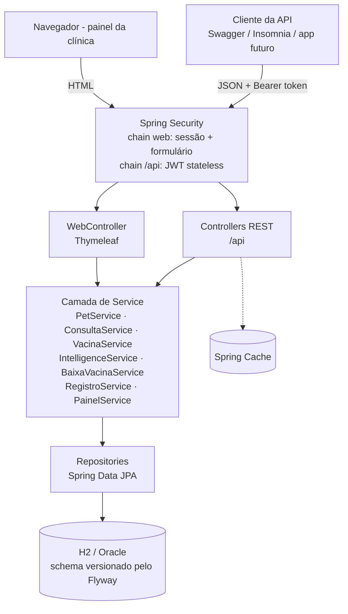
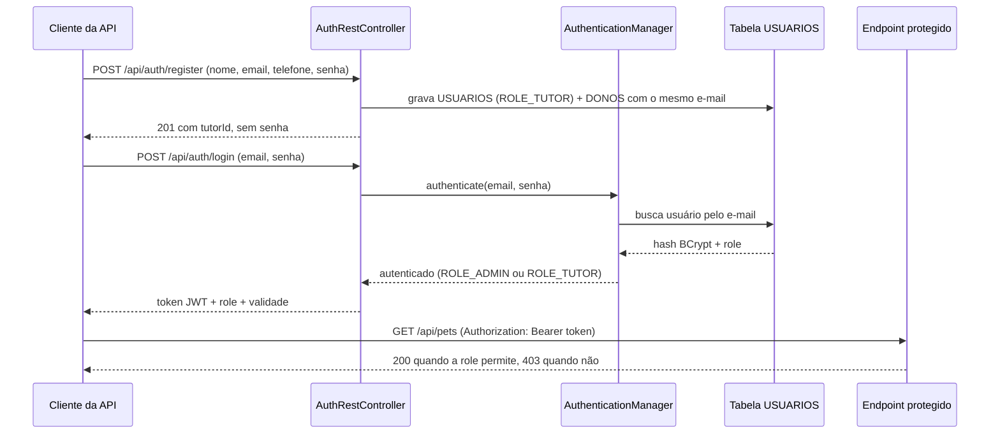
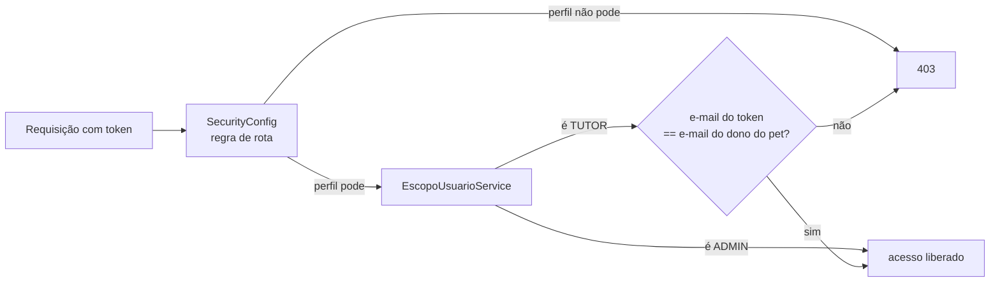
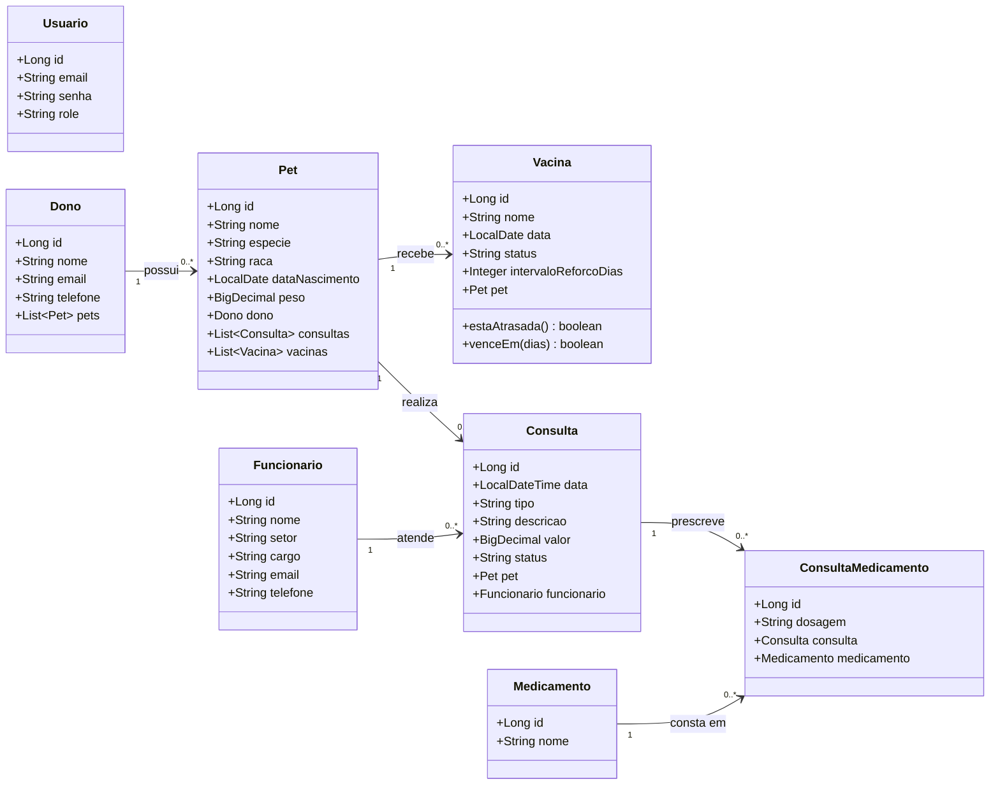
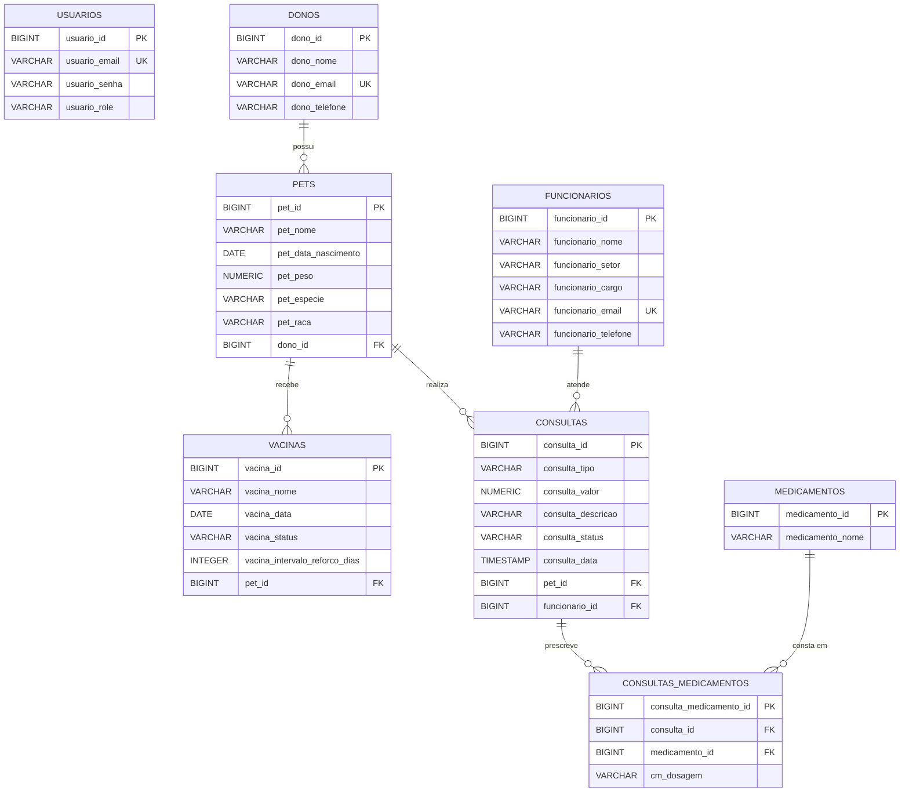
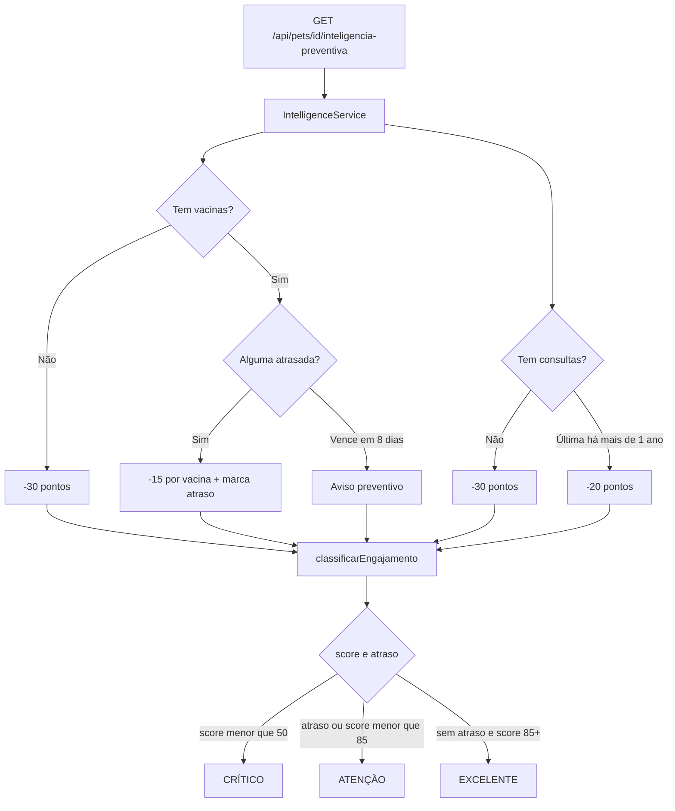
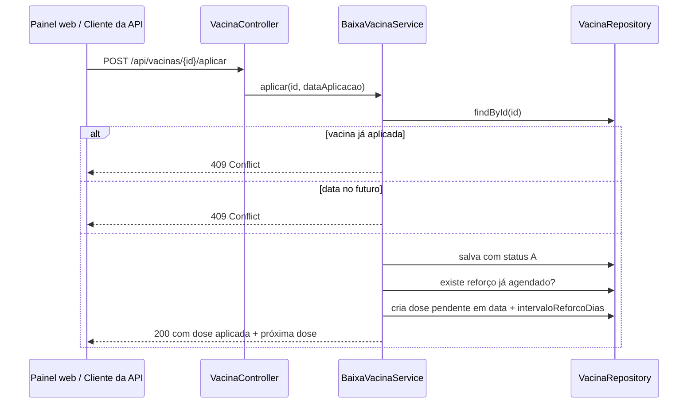

# 📊 Diagramas e Arquitetura — ClyvoVet Java API

Modelagem das entidades, arquitetura macro e desenho do banco da aplicação Spring Boot da ClyvoVet.

---

## 🏗️ 1. Arquitetura macro

A aplicação tem **duas portas de entrada** sobre a mesma camada de domínio: o painel web em Thymeleaf, usado pela clínica, e a API REST com JWT, usada hoje pelo Swagger e pelo Insomnia e preparada para um cliente mobile. O aplicativo Mobile atual do ClyvoVet usa o Supabase e não consome esta API.

### Divisão de responsabilidades

| Camada | Responsabilidade |
| :--- | :--- |
| **security** | Autenticação (BCrypt na tabela `USUARIOS`), emissão e validação do JWT, e as regras de quem acessa o quê |
| **controller** | Recebe a requisição, valida o DTO e delega. Não contém regra de negócio |
| **service** | Onde vivem as regras: score preventivo, baixa de vacina com reforço, cadastro de pet, montagem do painel |
| **repository** | `JpaRepository` com query methods |
| **model** | Entidades JPA. Regras próprias do calendário vacinal ficam na entidade `Vacina` |
| **dto** | Contratos de entrada e saída + Bean Validation |
| **exception** | Exceções de domínio e o `@RestControllerAdvice` que traduz cada uma para o status HTTP correto |

---

## 🔐 2. Fluxo de autenticação e autorização

| Recurso | ROLE_ADMIN | ROLE_TUTOR |
| :--- | :---: | :---: |
| Pets e consultas | todos | **apenas os seus** |
| Calendário vacinal | CRUD + baixa | leitura dos seus pets |
| Funcionários | CRUD | somente leitura |
| Medicamentos e cadastro de tutores | CRUD | ❌ 403 |

### Propriedade do recurso

O e-mail é o elo entre a credencial e o cadastro do tutor: `USUARIOS.usuario_email` e
`DONOS.dono_email` guardam o mesmo valor e ambas as colunas são únicas. Com isso dá para
saber de quem é cada pet sem criar chave estrangeira entre as duas tabelas.

No cadastro e na edição de pet, o `tutorId` enviado pelo cliente só é respeitado para o ADMIN:
para o TUTOR o vínculo é sempre o próprio usuário, o que impede transferir um pet para outra pessoa.

---

## 🧬 3. Diagrama de classes

> `Usuario` fica separada de `Dono` de propósito: nem todo usuário do sistema é tutor de um pet (o ADMIN da clínica, por exemplo), e nem todo tutor cadastrado precisa ter login.

---

## 🛢️ 4. Diagrama Entidade-Relacionamento (DER)

Modelo criado por `V1__create_tables.sql` e estendido por `V3__add_intervalo_reforco_vacina.sql`.

### Convenções do modelo

- **Domínios de status** guardados em `VARCHAR(1)`:
  - `vacina_status`: `P` = pendente, `A` = aplicada
  - `consulta_status`: `A` = agendada, `R` = realizada, `C` = cancelada
- **Idade não é coluna.** O banco guarda `pet_data_nascimento`, porque idade envelhece; o texto ("3 anos") é derivado na resposta.
- **`vacina_intervalo_reforco_dias`** é o que permite o agendamento automático da próxima dose no fluxo de baixa de vacina.
- **Chaves e índices**: todas as FKs são `NOT NULL` e nomeadas (`PETS_DONOS_FK`, `VACINAS_PETS_FK`, `CONSULTAS_PETS_FK`, `CONSULTAS_FUNCIONARIOS_FK`), com índices em `PETS(dono_id)`, `VACINAS(pet_id)`, `VACINAS(vacina_status)` e `CONSULTAS(pet_id)`.
- **O schema não é gerado pelo Hibernate** (`ddl-auto=validate`): o Flyway cria e versiona, e o Hibernate apenas confere se as entidades batem.

---

## 🔄 5. Os dois fluxos de negócio

### Fluxo 1 — Inteligência preventiva

Vacina atrasada **impede** o status EXCELENTE mesmo com score alto: um pet com pendência vencida não pode ser apresentado ao tutor como "em dia".

### Fluxo 2 — Baixa de vacina com reforço automático

