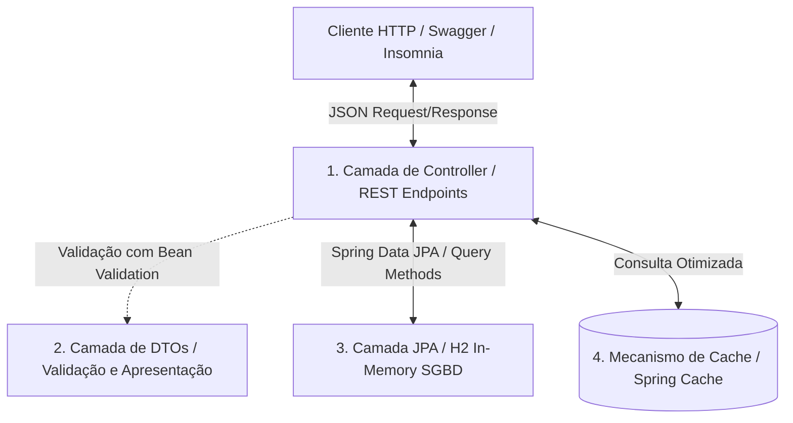
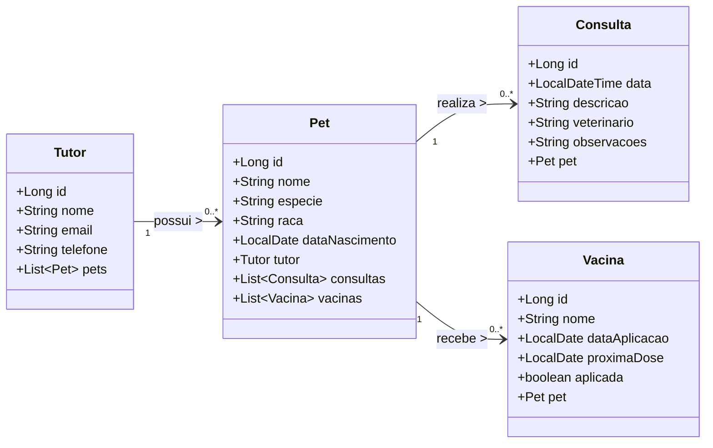
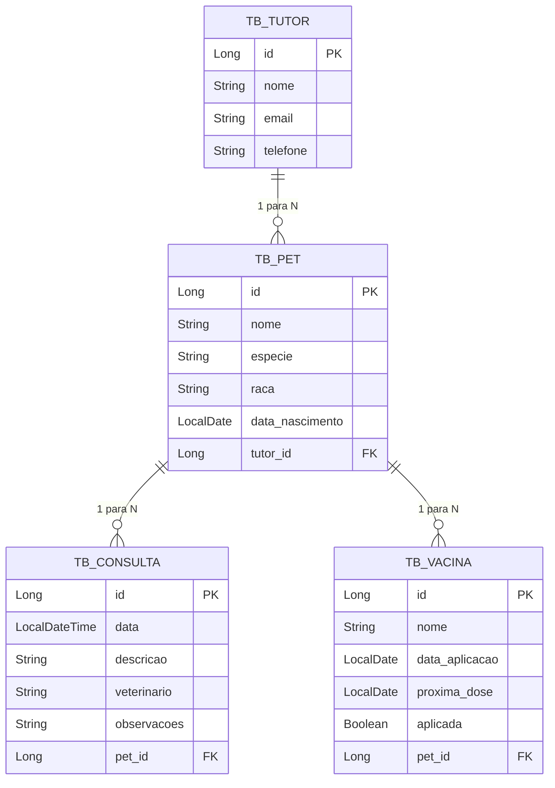

# 📊 Diagramas e Arquitetura do Sistema — ClyvoVet Java API

Este documento apresenta a modelagem de entidades, diagramas e a arquitetura macro adotada para o desenvolvimento da API RESTful Java da ClyvoVet.

---

## 🏗️ 1. Arquitetura Macro da Aplicação

A API ClyvoVet foi projetada seguindo os padrões arquiteturais clássicos do ecossistema **Spring Boot**, priorizando o baixo acoplamento e a alta coesão das classes.

### Divisão de Responsabilidades:
1. **Model**: Representação fiel do banco de dados relacional com anotações JPA.
2. **DTO (Data Transfer Object)**: Define a interface de comunicação de entrada (`RequestDTO`) e de saída (`ResponseDTO`). Protege o domínio interno e evita referências circulares em relacionamentos bidirecionais.
3. **Repository**: Extensões do `JpaRepository` contendo Query Methods personalizados.
4. **Controller**: Manipulação das requisições REST, conversão de DTOs, paginação/ordenação e suporte ao cache.
5. **Exception Handler**: Centralizador de erros do Spring Validation e RuntimeExceptions, garantindo o retorno dos status HTTP adequados (ex: 400 Bad Request, 404 Not Found).

---

## 🧬 2. Diagrama de Classes das Entidades

O diagrama abaixo descreve a estrutura de herança, tipos de dados e os atributos das classes de domínio que compõem o escopo de saúde preventiva da ClyvoVet.

---

## 🛢️ 3. Diagrama Entidade-Relacionamento (DER) / MER

Modelo relacional lógico indicando chaves primárias, chaves estrangeiras e a cardinalidade dos relacionamentos.

### Explicação das Constraints e Relacionamentos:

1. **TB_TUTOR para TB_PET (1:N)**:
   - **Constraint**: `tutor_id` na tabela `TB_PET` é uma Chave Estrangeira (`FOREIGN KEY`) obrigatória (`NOT NULL`) referenciando `TB_TUTOR(id)`.
   - **Comportamento**: Cascade do tipo `ALL` habilitado na entidade JPA. Se um Tutor for removido do sistema, todos os seus Pets vinculados serão removidos em cascata para evitar órfãos.

2. **TB_PET para TB_CONSULTA (1:N)**:
   - **Constraint**: `pet_id` na tabela `TB_CONSULTA` é uma `FOREIGN KEY` obrigatória referenciando `TB_PET(id)`.
   - **Comportamento**: A deleção em cascata também é configurada. Caso o Pet seja excluído de forma longitudinal, seu histórico de consultas é apagado automaticamente.

3. **TB_PET para TB_VACINA (1:N)**:
   - **Constraint**: `pet_id` na tabela `TB_VACINA` é uma `FOREIGN KEY` obrigatória referenciando `TB_PET(id)`.
   - **Comportamento**: Permite rastrear todo o calendário de vacinas aplicadas e futuras de um animal específico.
